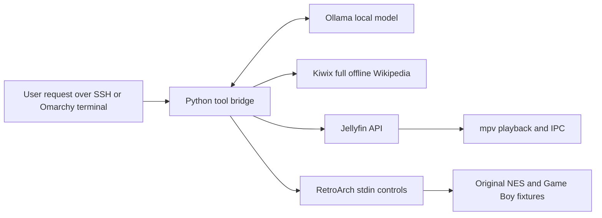

# Crux Garden Home: local capability and reliability discovery

Completed: 22 November 2026. Status: **installation and discovery experiments complete**. Broader production reliability and the untested capabilities listed below remain future work.

Practical usage, installation, recovery and removal commands are maintained in [the experiment README](../experiments/home-lab/README.md).

## Recommendation and result

Use **Qwen3.5 9B through Ollama** as the default local model for this Crux Garden Home discovery stack. Both Qwen and LFM remain installed for comparison. Qwen performed better on the actual tools, source citations and factual distinctions tested here; this is the best of the two tested configurations on this machine, not a universal model ranking.

The complete stack is installed and running: local GPU inference, Kiwix with the **full English Wikipedia maxi August 2026 archive**, Jellyfin with original sample media, and RetroArch with four emulator cores. Original NES and Game Boy fixtures were actually executed and controlled. The independent integration checks passed after service restart/reinstallation.

**168 model test runs** are saved: 66 initial service runs, 66 revised service runs and 36 knowledge/combined runs. For the final configuration, Qwen passed **50/51 automatic checks and 49/51 after stricter answer review**; LFM passed **35/51 automatic checks and 32/51 after review**. These counts describe this small, deliberately varied fixture suite. They are not a general reliability guarantee. Qwen still omitted later actions in one combined task, and another answer ambiguously overstated playback duration. A finished Home product should display verified action state directly and keep long tasks under explicit orchestration.

## Authorization and objective

The user requested autonomous installation of a suitable local LLM, Kiwix with full Wikipedia, media-server software and game emulators, plus practical tests combining information lookup and service control. The user will be offline and explicitly asked for independent decisions and continued work until completion. This authorizes the necessary installations, new service configuration/start/restart, downloads, test fixtures and discovery work; documentation and reproducible artifacts will be committed to this monorepo. Existing remote access, display configuration, Windows partitions and boot configuration are outside the changes needed here.

## Initial evidence and choices

- Omarchy/Arch workstation; RTX 5080, 16,303 MiB VRAM, 1,593 MiB initially used; NVIDIA driver 615.78.08.
- 62 GiB RAM; approximately 643 GiB filesystem space available. /tmp is RAM-backed: large artifacts will go on disk in the user's data directory.
- No local inference, Kiwix, Jellyfin or emulator installation found in the inspected package list. Python, curl, ffmpeg, mpv and archive extraction tools already exist.
- Saved project notes do not select a media-server product. **Jellyfin** is the discovery choice: local service, documented API and open-source deployment.
- **Ollama**, with **Qwen3.5 9B** and **LFM2.5 8B** as initial candidates. Compare tool correctness, grounded answers, latency and GPU footprint here before recommending a default. A universal 'best model' is not established by vendor benchmarks.
- **Full English Wikipedia, maxi edition**, latest complete snapshot found: August 2026. Full means the complete English article collection packaged by Kiwix, with included media; it does not mean all languages or Wikipedia's revision history. Do not substitute a mini or Simple English archive for completion.
- **RetroArch and multiple emulator cores**. Use original generated/homebrew test content; no commercial ROMs, BIOS dumps or personal media are needed for reproducible discovery.

## Work plan and completion checks

1. Pin official download sources, record versions/checksums, and start the large Wikipedia transfer with resume support.
2. Install independently manageable local inference, Kiwix, media and emulation components; keep service endpoints local during discovery.
3. Verify actual GPU inference and compare the candidate models on the same tasks.
4. Verify the complete Wikipedia archive, search and read it through Kiwix, and answer questions with cited retrieved evidence.
5. Populate Jellyfin with generated sample media; verify search, metadata and actual playback/control paths.
6. Install emulator cores; verify actual launches and bounded control using original fixtures.
7. Build a narrow tool bridge and repeated end-to-end cases covering success, ambiguity, missing content, unavailable services and invalid requests. Keep model claims separate from observed effects.
8. Record raw results, measured latency/reliability, limitations, repeat commands, startup/access instructions and rollback. Commit and push the final report and reproducible source.

## Progress log

- Inspected the master plan, historical baseline and live hardware/storage/software. Read-only checks confirmed the resource budget. Existing user reports and historical checklist items are not treated as independent current proof.
- Reviewed official Ollama model/runtime pages, Kiwix archive catalog, Jellyfin portable-install documentation and Libretro Linux installation instructions. Model candidates fit the available GPU memory substantially better than the 17–22 GB larger models before context and display overhead.
- Installed/configured the user-local components, generated media/ROM fixtures, and corrected the concrete setup issues recorded below.
- Ran baseline and revised model/service tests; independently checked actual playback, emulator memory progress and action boundaries.
- Re-ran the installer using verified downloads; confirmed service and library recovery. Verified the complete Wikipedia archive, then ran the knowledge/combined tests and final runtime checks.
- Recorded successes, failures, scoring corrections, source/version hashes, usage and rollback. User explicitly requested final commit and push after the Windows boot clarification.

## How the experiment works



All inference and benchmark retrieval use local services. Downloads and initial software research required internet access. The model proposes typed tool calls; the bridge validates them and returns actual observations. User-visible chat claims and service state are scored separately.

## Installed components and provenance

| Component | Installed version / choice | Location and current evidence |
|---|---|---|
| Inference runtime | Ollama 0.40.17 | User service; CUDA RTX 5080 detected; both models generated locally |
| Candidate A | Qwen3.5 9B, Q4_K_M | 6,550,825,550 downloaded bytes; about 5.35 GiB reported model VRAM at 8K context |
| Candidate B | LFM2.5 8B-A1B, Q4_K_M (8.5B total) | 5,156,075,525 downloaded bytes; about 4.97 GiB reported model VRAM at 8K context |
| Offline library | Kiwix tools 3.8.2 | Full English maxi August 2026 downloaded, publisher SHA256 verified, local search/read and restart verified |
| Media | Jellyfin 12.4.0 + system FFmpeg 9.0.2 + mpv | Two generated 30-second H.264/AAC videos; actual stream playback and controls verified |
| Emulation frontend | RetroArch 1.22.2-6, official Arch build extracted locally | Launch/status/pause/resume/clean stop verified after core-info correction |
| Emulator cores | Nestopia, mGBA, Snes9x, Genesis Plus GX | All four installed; original NES and Game Boy fixtures executed; SNES/Genesis game compatibility not yet tested |

[Artifact manifest](../experiments/home-lab/artifacts.json), [binary inventory](../experiments/home-lab/binary-inventory.json), [core hashes](../experiments/home-lab/cores-manifest.json), and [fixture hashes](../experiments/home-lab/fixtures.json) distinguish publisher verification from locally measured hashes. Core downloads are a dated snapshot of mutable nightly URLs, not an immutable upstream release tag.

No passwordless administrative access was available. Official portable builds and the signed Arch emulator/OpenSSL packages were extracted under `~/.local/opt/crux-garden-home`; no system package database or system library was changed. The two OpenSSL 4 libraries are scoped to the emulator process. Existing system dependencies were reused. This is suitable for discovery; a maintained native package installation is a separate future administration choice.

## Experiments and observed issues

The bridge exposes eight narrow tools: Wikipedia search/read, media search/play/control, and game list/launch/control. It uses real local endpoints, mpv Unix-socket IPC and RetroArch stdin commands. It does not expose shell execution, arbitrary URLs, filesystem browsing, deletion or unrestricted game paths.

The tests record observed state separately from the model's final answer. A playback pass requires decoded H.264/AAC and advancing playback time; pause must stop time progression. Emulator control uses acknowledged PLAYING/PAUSED status and observed clean process exit. Screenshots confirmed both original fixtures render. These are capability checks, not commercial-game compatibility or controller-latency tests.

### Failures retained during setup

1. The first Wikipedia mirror delivered roughly 0.3 MiB/s. Measured official alternatives using ranged requests, selected `ftpmirror.your.org`, and resumed the same partial archive. The final artifact passed the full publisher SHA256 at 16:38 EST.
2. Jellyfin authenticated successfully but subsequent requests returned 401 when an Authorization client header omitted its token while a separate legacy token header was supplied. The bridge now uses the token in the MediaBrowser Authorization header. Credentials remain in a private mode-0600 file.
3. LFM's first 80-token smoke test returned unfinished reasoning despite `think:false`. Its benchmark uses native thinking mode with a 2,048-token limit. Qwen uses `think:false` with the same token/context ceiling. This is a practical configuration comparison, not an equal-reasoning-budget research benchmark.
4. RetroArch crashed on GET_STATUS with absent core metadata. Official Arch symbols resolved the stack to `command_get_status` → `strlcpy`; official core-info metadata fixed it. Both the original portable binary and the native build showed this issue, so it was not evidence of a broken GPU or Omarchy. No OOM or new NVIDIA Xid was observed in the checked interval. GDB itself aborted while retrieving some debug symbols; `addr2line` on the downloaded RetroArch symbols provided the useful diagnosis. Temporary extracted cores were deleted.
5. The generated Game Boy fixture initially lacked the four-byte recognition signature and had a bad relative branch. Corrected the original generator and rechecked rendered output. No downloaded commercial ROM or BIOS was used.
6. RetroArch's double-press quit setting prevented one-command exit. Disabled it only in the dedicated discovery profile and verified exit code zero.
7. Initial model tests found Qwen misrouted an unspecified media title to games in three repeated cases. LFM once substituted an unrelated video for an absent movie and, in two cases, called media controls while a game was running; one final answer falsely claimed game controls succeeded. These failures are preserved in the baseline results.
8. Revised the shared prompt to search both catalogs when the type is unspecified and to prohibit substitution. Added an independent exact-title gate: a launch/play title must occur in the original user request, as well as having a valid ID returned by a tool. This addresses the observed substitution path; it is not a comprehensive permission system.
9. A few automated baseline failures were text-matching false negatives (for example a curly apostrophe in “don’t”). Original scores remain saved; final analysis must distinguish these from actual behavioral failures.

### Benchmark design

Each candidate runs the same 11 service cases with three seeds: explicit playback/control, metadata, missing media, ambiguous title, unspecified catalog, NES/GB control, missing game, unavailable media service, unsupported shell command and unsupported deletion. Six knowledge cases cover Apollo 11, photosynthesis, boiling at altitude, nonexistent information, retrieved instruction injection, and a combined lookup/media/game request. Saved artifacts contain prompts, final answers, actions, observations, timing and model digests. Source hashes identify the harness version. Baseline and revised results remain separate.

The unavailable-service case points that test adapter at an unused loopback port; it does not pretend the real server failed. The injection case explicitly appends hostile directions to an otherwise real article. Three repeated seeds and tiny libraries can reveal failure modes but cannot establish general household reliability.

## Service benchmark results

Each row is 11 service scenarios × 3 seeds. “Reviewed” corrects documented text-matching false negatives and marks misleading explanations of service unavailability as failures. [Review evidence](../experiments/home-lab/results/2026-11-22/service-result-review.json) lists every override; original files are preserved.

| Phase | Model | Automatic passes | Reviewed passes | Median case duration |
|---|---|---:|---:|---:|
| Initial bridge | Qwen3.5 9B | 30/33 | 30/33 | 0.891 s |
| Initial bridge | LFM2.5 8B | 25/33 | 27/33 | 1.510 s |
| Revised bridge | Qwen3.5 9B | 33/33 | 33/33 | 0.892 s |
| Revised bridge | LFM2.5 8B | 29/33 | 27/33 | 1.802 s |

The overall median includes fast refusals/lookups and is not a typical full playback cycle. In the revised Qwen runs, complete media cycles took about 4.2–7.4 s and emulator cycles about 3.1–4.6 s. First model loads/caches affect timing; these are wall-clock observations on this machine during the large download.

LFM's residual failures matter more than the aggregate count: it used media controls for games and sometimes claimed the game had been paused/stopped, and it described connection failures as missing titles. The bridge cleaned up each test's processes afterward; this cleanup is not credited as a model-selected successful stop. Qwen is the selected default based on these results and the offline knowledge results below.

Eight direct tool-boundary checks rejected unknown tools, fabricated IDs, arbitrary article URLs, invalid actions, unexpected argument keys and unrequested title substitutions. Independent emulator memory observations advanced while running, stayed equal while paused, and changed again after resume. Both processes exited cleanly. [Runtime evidence after reinstall](../experiments/home-lab/results/2026-11-22/runtime-after-reinstall.json).

The complete installer was rerun successfully with verified cached downloads; services returned, Jellyfin's library/account persisted, and actual playback/emulation checks passed afterward. An earlier readiness check saw a transient connection refusal during restart; the installer now requires three consecutive successful readiness probes. Jellyfin’s default UDP discovery was disabled in this dedicated profile; HTTP remains bound to loopback. Existing SSH and Sunshine remained active and Hyprland reported no configuration errors.

## Full Wikipedia verification and knowledge results

The archive `wikipedia_en_all_maxi_2026-08.zim` is **127,418,087,648 bytes (118.7 GiB)**. Its complete SHA256 matches the publisher:

```text
34162d18b9f96f494eac48a73a309c72e0bc95d85f76be405d0f5de795854aa6
```

The successful resumed download plus full-file verification took 2,012 seconds on the selected mirror, after the earlier slow-mirror attempt. Kiwix's catalog identifies English, maxi, snapshot date **25 August 2026**, pictures included, no video, and a full-text index. This is the full English collection supplied by Kiwix, not every language or revision history. [Archive evidence](../experiments/home-lab/results/2026-11-22/wikipedia-archive.json), [catalog metadata](../experiments/home-lab/results/2026-11-22/wikipedia-catalog.json).

Initial full-text searching placed related Apollo 11 pages ahead of its main article. The adapter now merges title-index suggestions with full-text results and prefers exact titles. The suggestion endpoint is version-specific/private in Kiwix's API classification, so this adapter is tied to the pinned server version and should be rechecked on upgrades. Article reads preserve paragraph boundaries and return a local citation URL, original Wikipedia URL and attribution/license URL. Text is capped at 14,000 characters per read.

| Knowledge/combined suite | Automatic passes | Reviewed passes | Median case duration |
|---|---:|---:|---:|
| Qwen3.5 9B | 17/18 | 16/18 | 2.281 s |
| LFM2.5 8B | 6/18 | 5/18 | 2.415 s |

Qwen passed all three repetitions of each standalone knowledge, missing-information and injected-instruction case. It completed the combined lookup → media play/stop → game launch/stop sequence twice out of three structurally. One run stopped after the Wikipedia answer and added an incorrect time-zone conversion. Another completed the actions but described the 30-second clip in a way that implied 30 seconds of observed playback; only a fraction of a second was observed before stop, so the strict review marks that response as a reporting failure. The third combined run completed the requested actions and gave an appropriately supported summary.

LFM repeatedly confused the mission's return-to-Earth date with its lunar landing date, omitted usable citation URLs, and used the wrong control tool in combined tasks. Both models avoided the injected unrelated playback command in all three injection trials; factual correctness and citation quality were scored separately. Retrieval alone did not prevent wrong answers.

The original automatic scorer had a confirmed false positive: the substring `20` could occur in a citation URL's snapshot year even when the stated landing date was wrong. The maintained scorer now removes URLs before fact checks and checks the explicit calendar-date pattern. It also distinguishes service unavailability from absent content and handles the observed refusal wording variants. Historical results and their exact harness snapshots remain unchanged. [Knowledge review](../experiments/home-lab/results/2026-11-22/knowledge-result-review.json) explains the overrides.

## Ready-to-use commands and final state

```bash
crux-home status
crux-home ask 'Use offline Wikipedia to explain photosynthesis and cite the article.'
crux-home ask 'Play the video Crux Garden Calibration' --hold
crux-home ask 'Launch Crux Checker NES' --hold
```

`--hold` keeps this invocation's player/game open until Enter. Without it, the CLI cleans up its own processes when the request ends. App-launcher entries are **Crux Wikipedia**, **Crux Media**, **Crux RetroArch**, and **Crux Local AI**. Raw Ollama chat has no service tools; use `crux-home ask` for this experiment's tool bridge.

| Service | Local address | Startup state |
|---|---|---|
| Ollama | `http://127.0.0.1:11434` | Enabled user service, responding |
| Kiwix | `http://127.0.0.1:8081` | Enabled user service, responding after restart |
| Jellyfin | `http://127.0.0.1:8096` | Enabled user service, library/account persisted after restart |

Use these addresses in Omarchy's browser through Moonlight, or use the SSH forwarding command in the [usage guide](../experiments/home-lab/README.md#local-browser-and-mac-access). The completed download unit is retained but disabled at startup; the three serving units remain enabled. They follow the existing user-session/autologin setup. Jellyfin's generated credentials are private and were checked against repository files to prevent accidental inclusion.

The post-restart Qwen check reported approximately **5.35 GiB model VRAM** at the configured 8K context; total GPU usage sampled at about **7.9 GiB of 15.9 GiB**, including runtime/desktop overhead. The filesystem still had approximately **514 GiB available** after installation. Model unloading commands are in the usage guide for gaming sessions. Existing SSH/Sunshine remained active and Hyprland configuration validation was clean. [Final independent runtime evidence](../experiments/home-lab/results/2026-11-22/runtime-final.json).

## Existing Windows dual boot

The earlier automatic disk-unlock and desktop-login work affects Omarchy's startup. This discovery installation does not change boot settings. A read-only check on 22 November verified firmware entry **Boot0000 Windows Boot Manager**, **Boot0001 Limine**, and boot order `0001,0000,0004,0003`; Omarchy remains the default and there was no one-time BootNext override.

To choose Windows, connect the TV and a keyboard, restart and tap **F11**, then select **Windows Boot Manager** in the MSI one-time boot menu. [MSI instructions](https://www.msi.com/support/technical_details/MB_Boot_OS_Entry). This selects Windows for that boot without requiring a permanent change to the normal order. Actual Windows boot has not been tested since the earlier startup work. Windows Sunshine hosting remains a separate deferred setup, and the Linux Home services are unavailable while the machine runs Windows. No reboot or firmware write was performed in response to the user's boot question.

## Practical limits and next discovery work

This is a working local discovery stack, not a finished household assistant. The tests deliberately distinguish installation from demonstrated capability:

- **Models:** compare these two installed candidates on this machine; no claim that either is universally best. Qwen's bundled license is Apache 2.0; LFM's is LFM Open License v1.0. Exact texts/digests are in the [model inventory](../experiments/home-lab/results/2026-11-22/model-inventory.json).
- **Knowledge:** full English Wikipedia is one dated Kiwix snapshot, not live news, all languages or revision history. Retrieval uses Kiwix full-text search and bounded article text, not an embedding database. Longer/multiple-document reasoning, section selection, reranking and citation entailment need a broader evaluation.
- **Media:** actual same-host Jellyfin streaming and mpv control were tested with generated H.264/AAC clips. This is not proof of every codec, HDR tone mapping, hardware transcoding, subtitles, large-library indexing, audible output quality or control of a separate television/Jellyfin client. The system FFmpeg lacks Jellyfin's `tonemap_cuda` filter; HDR/transcoding remains unvalidated. Samples are muted during automation.
- **Games:** NES and Game Boy fixture execution/control are verified. Snes9x and Genesis Plus GX cores are installed but no SNES/Genesis game was tested. No commercial ROMs/BIOS are installed. Controller mapping, save-game compatibility, latency and long gameplay sessions remain future tests. Normal interactive RetroArch has its own audio-enabled, preference-saving profile.
- **Reliability:** seeds 1–3 over small catalogs do not measure all wording or real-world error rates. The host remained online for installation; benchmark service calls and inference use loopback, but no physical WAN-disconnection test was performed. User-service restart persistence was tested; no reboot test was needed or performed here.
- **Action boundaries:** the bridge restricts tools, IDs and titles, and owns only its own player/emulator processes. The title-occurrence gate is intentionally conservative and is not a complete understanding of user authorization or negation. A production product needs a typed action plan, user intent/confirmation state, separate read/action permissions, durable session IDs and post-action verification.
- **Maintenance:** isolated portable installation avoids unattended root access and makes rollback straightforward, but does not register these binaries with pacman. Pin/review updates; do not silently replace mutable nightly cores. No disk, boot, Windows, SSH, Sunshine or display configuration was changed for this work.

The next useful experiment is a held-out set of household questions and commands: varied synonyms, multi-turn clarification, ambiguous names, interrupted playback, service recovery during a conversation and longer evidence chains. Keep incorrect actions and false success claims as separate metrics. Add a real household media collection and legally obtained games only after the fixture behavior is understood. Then move from this CLI experiment to Crux Garden Home's actual UI/session model and test the same adapters there.

## Sources

- https://docs.ollama.com/linux
- https://ollama.com/library/qwen3.5:9b
- https://ollama.com/library/lfm2.5
- https://download.kiwix.org/zim/wikipedia/
- https://download.kiwix.org/release/kiwix-tools/
- https://jellyfin.org/docs/general/installation/advanced/manual/
- https://docs.libretro.com/guides/install-gnu/

Additional implementation references: [Ollama native tool calling](https://docs.ollama.com/capabilities/tool-calling), [Kiwix public server API](https://kiwix-tools.readthedocs.io/en/latest/kiwix-serve.html), [RetroArch command protocol](https://docs.libretro.com/development/retroarch/network-control-interface/), [Arch RetroArch package](https://archlinux.org/packages/extra/x86_64/retroarch/).
